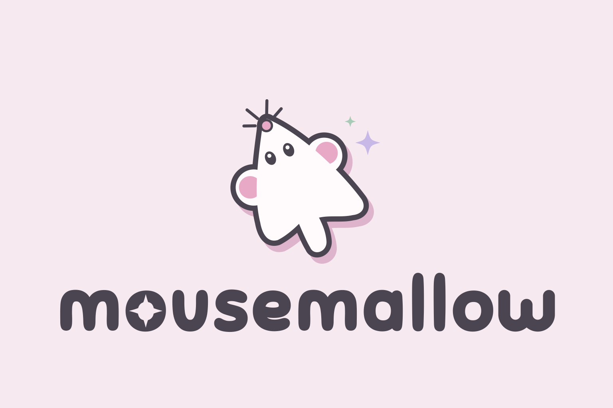
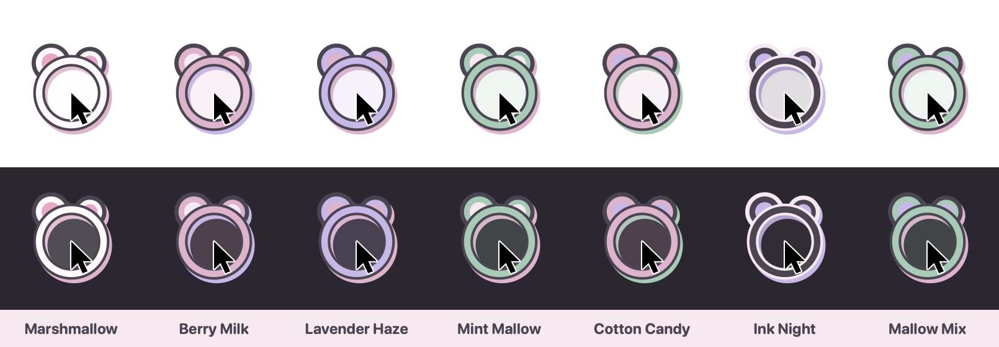
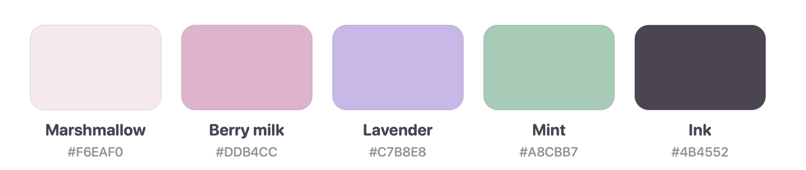

<p align="center">
  
</p>

<p align="center"><b>make your cursor a little cuter ♡</b></p>

mousemallow is a small macOS menu bar app that dresses up your cursor. It puts a pastel ring with mouse ears around the arrow, leaves a trail of mini marshmallows behind it, and helps you find the cursor when you lose it.



## What it does

- Draws a ring around the arrow: plain, double, dotted (it spins) or a soft blob. Add mouse, cat or bunny ears, or a bow.
- Gives the ring an ink outline and a sticker shadow, so pastel colors still show up on white pages.
- Leaves a particle trail: mini mallows, hearts, sparkles, stars, bubbles, petals or confetti.
- Grows the ring to about 3x and sends out two ripples when you circle or shake the mouse.
- Moves the cursor to the center of your main screen when you press **⌃⌥C**. You can record a different shortcut in Settings, including a single F-key.
- Ripples on click, leans into turns, and can fade out when the mouse sits still.
- Comes with seven themes in the mousemallow palette, plus a theme with your own two colors.

Everything lives in the menu bar icon. Pick **Settings…** for the full list of options.

## Install

You need macOS 14 or later, on Apple silicon or Intel.

### Download

1. Download `mousemallow.zip` from the [latest release](https://github.com/coenradina/mousemallow/releases/latest) and unzip it.
2. Drag `mousemallow.app` into your Applications folder and open it.
3. macOS will say it can't check the app for malware, because the app isn't notarized by Apple. Click **Done**, then open **System Settings → Privacy & Security**, scroll down, and click **Open Anyway** next to mousemallow. You only need to do this once.
4. To start it with your Mac, turn on **Open at login** in the app's Settings.

### Build from source

You need the Xcode Command Line Tools (`xcode-select --install`).

```sh
git clone https://github.com/coenradina/mousemallow.git
cd mousemallow
./build.sh
open build/mousemallow.app
```

To keep it, drag `build/mousemallow.app` into your Applications folder, then turn on **Open at login** in Settings.

mousemallow doesn't ask for any permissions and makes no network requests.

## How it works

macOS doesn't let apps replace the system cursor everywhere, so mousemallow keeps the normal arrow and draws next to it. Each screen gets a transparent window that ignores clicks and sits above other windows. The app reads the cursor position 120 times a second while the mouse moves and 20 times a second at rest, and draws with Core Animation. At rest it uses under 1% CPU.

The summon shortcut is a Carbon global hotkey, and the jump uses `CGWarpMouseCursorPosition`.

| File | What's in it |
| --- | --- |
| `Sources/main.swift` | The app: overlay, themes, settings window, menu bar menu |
| `Sources/Brand.swift` | Palette colors, the logo mark and the wordmark, drawn in code |
| `Resources/` | The Sniglet font for the wordmark, and its license |
| `Tools/render_assets.swift` | Draws everything in `assets/` (logo, app icon, previews) |
| `build.sh` | Compiles a universal app and regenerates `assets/` |

## Palette



| Name | Hex |
| --- | --- |
| Marshmallow | `#F6EAF0` |
| Berry milk | `#DDB4CC` |
| Lavender | `#C7B8E8` |
| Mint | `#A8CBB7` |
| Ink | `#4B4552` |

## License

[MIT](LICENSE)

The wordmark uses [Sniglet](https://fonts.google.com/specimen/Sniglet) by Haley Fiege, under the [SIL Open Font License 1.1](Resources/OFL.txt). The app bundles the font file unchanged. The round "w" and the thicker strokes are drawn in code.
